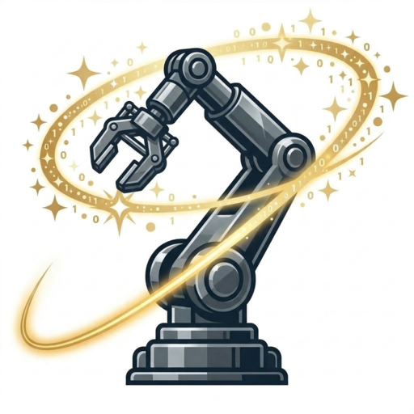
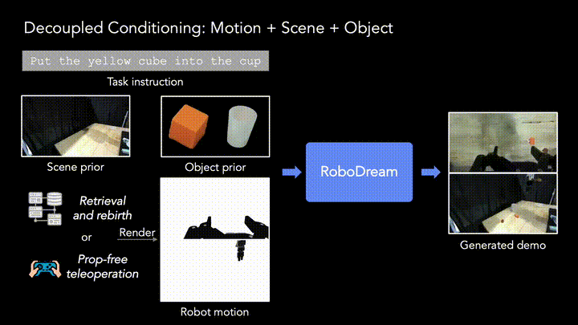

<div align="center">



# RoboDream: Compositional World Models for Scalable Robot Data Synthesis

[](https://arxiv.org/abs/2606.02577)
[](http://junjieye.com/RoboDream/)
[](https://huggingface.co/Jay-Ye/RoboDream)
[](LICENSE)

**[Junjie Ye](https://jay-ye.github.io/)<sup>1,2</sup>, [Rong Xue](https://rongxuezoe.github.io/)<sup>1</sup>, [Basile Van Hoorick](https://basile.be/)<sup>2</sup>, [Runhao Li](https://www.linkedin.com/in/runhao-li-lee021004/)<sup>1</sup>, [Harshitha Rajaprakash](https://harshithabr.github.io/)<sup>1</sup>, [Pavel Tokmakov](https://pvtokmakov.github.io/home/)<sup>2</sup>, [Muhammad Zubair Irshad](https://zubairirshad.com/)<sup>2</sup>, [Vitor Guizilini](https://vitorguizilini.github.io/)<sup>2,&dagger;</sup>, [Yue Wang](https://yuewang.xyz/)<sup>1,&dagger;</sup>**

<sup>1</sup>USC Physical Superintelligence (PSI) Lab &nbsp;&nbsp; <sup>2</sup>Toyota Research Institute &nbsp;&nbsp; <sup>&dagger;</sup>Equal advising



</div>

## Abstract

RoboDream is a generalizable embodiment-centric world model for scalable robot data synthesis. It anchors generation to rendered robot motion while conditioning on explicit scene and object priors, decoupling trajectory execution from environment synthesis to produce photorealistic demonstrations with novel objects, scenes, and viewpoints. This enables *retrieval and rebirth* (repurposing existing trajectories into new contexts) and *prop-free teleoperation* (operators manipulate empty air while the model hallucinates objects and scene). Real-world experiments show the generated data consistently improves downstream policy performance and substantially reduces real-world data requirements.

## Overview

RoboDream is an embodiment-centric video world model that synthesizes robot demonstrations with **novel objects**, in **novel scenes**, from **novel views**. It conditions a video diffusion model ([Cosmos-Predict2-2B](https://github.com/nvidia-cosmos/cosmos-predict2)) on three decoupled inputs — a **rendered robot-only trajectory**, a **scene prior** and an **object prior** — which enables two data-scaling modes:

- **Retrieval and rebirth**: retrieve DROID trajectories for a new task by instruction similarity, re-render them from the target camera, and "rebirth" them in a new scene with new objects.
- **Prop-free teleoperation**: teleoperate without physical objects (real robot or simulator); RoboDream paints the objects in afterwards.

## Repository layout

| Path | What it does |
|---|---|
| [`data_processing/`](data_processing/README.md) | DROID → robot-only renders + object/scene priors (GPT-5-nano → Grounded-SAM → OmniPaint) → training clips + T5 cache |
| [`replay/`](replay/README.md) | Isaac Lab replay of end-effector trajectories to render robot-only videos (training data and inference) |
| [`robodream/`](robodream) | The model as a standalone PyTorch package: two-view DiT (`network.py`), stream packing (`logistics.py`), sampling and training loss (`pipe.py`), DROID clip dataset (`dataset.py`), long-video generation (`generate.py`); `vendor/` is a trimmed plain-PyTorch subset of Cosmos-Predict2 |
| [`scripts/`](scripts) | `train.py` (DDP / FSDP2), `server.py` (HTTP inference server used by `generation/`), `run_demos.py` (demo cases without a server) |
| [`demos/`](demos), [`notebooks/`](notebooks) | Ready-made inputs (robot-only renders, trajectories, priors, instructions) for retrieval & rebirth, prop-free teleoperation and compositional generation, and a notebook that runs them |
| [`generation/`](generation/README.md) | Deployment client: retrieval & rebirth, prop-free teleoperation, multi-view generation |
| [`shell/`](shell), [`docker/`](docker) | Container build / launch, path setup, checkpoint download, training and server launchers |

## Released artifacts (Hugging Face)

| Repo | Content | Size |
|---|---|---|
| [`Jay-Ye/RoboDream`](https://huggingface.co/Jay-Ye/RoboDream) | Model weights (`model.pt`) + default-instruction embedding (`default_text_emb.pt`) | 4 GB |
| [`Jay-Ye/RoboDream-Data`](https://huggingface.co/datasets/Jay-Ye/RoboDream-Data) | Training data for ~41k DROID episodes: Isaac Lab robot-only renders (`renders/`, ~305 GB), scene/object priors and object masks (`shards/`, ~12 GB), T5 instruction embeddings, splits and camera extrinsics (`meta/`, ~4 GB) | ~320 GB |

The raw DROID data itself is not redistributed; download it from the [DROID release](https://droid-dataset.github.io/). Training reads clips directly from the per-episode layout built from DROID + the priors and renders above (see [`data_processing/`](data_processing/README.md)).

## Setup

Everything runs inside Docker.

```bash
git clone https://github.com/Jay-Ye/RoboDream.git robodream && cd robodream
cp .env.example .env            # set CKPT_DIR / DATA_DIR / OUTPUT_DIR / DROID_DIR and optional tokens
bash shell/build_docker.sh
bash shell/run_docker.sh # mounts the repo at /workspace and the .env folders under /workspace/*
```

Inside the container:

```bash
source shell/export.sh              # sets ROBODREAM_* paths and PYTHONPATH
bash shell/download_checkpoints.sh  # Cosmos-Predict2-2B (VAE + base DiT), T5-11B, RoboDream weights
huggingface-cli download Jay-Ye/RoboDream-Data meta/droid_t5_text_embeddings.pkl.gz \
    --repo-type dataset --local-dir ${ROBODREAM_DATA_DIR}/hf/data && \
    ln -sf ${ROBODREAM_DATA_DIR}/hf/data/meta/droid_t5_text_embeddings.pkl.gz ${ROBODREAM_DATA_DIR}/
```

All paths are configured through `.env` (host side) and `shell/export.sh` (container side); no path is hard-coded in the code.

| Variable | Container default | Used for |
|---|---|---|
| `ROBODREAM_CKPT_DIR` | `/workspace/checkpoints` | Cosmos base model, T5, RoboDream weights |
| `ROBODREAM_DATA_DIR` | `/workspace/datasets` | processed episodes, priors, renders, T5 cache, retrieval trajectories |
| `ROBODREAM_OUTPUT_DIR` | `/workspace/outputs` | training logs/checkpoints, generated demonstrations |
| `DROID_ROOT` | `/workspace/droid` | raw DROID (data processing and retrieval only) |

## Demo

[`notebooks/robodream_demo.ipynb`](notebooks/robodream_demo.ipynb) downloads the released weights and reproduces the three result types of the project page from the inputs in [`demos/`](demos), then composes them into side-by-side videos: retrieval & rebirth (input priors / generated / retrieved DROID episode), prop-free teleoperation (teleoperation without objects / generated demonstrations with different objects) and compositional generation (one trajectory with a novel object instance, scene, task or camera view). Each case ships the inputs the full pipeline would produce (Isaac Lab robot-only renders, end-effector trajectory, scene and object priors, instruction), so the demo needs neither Isaac Lab nor the prior-extraction models. One GPU is enough (peak memory about 7 GB); the nine cases take about 10 minutes on an A100.

```bash
# inside the container
pip install jupyterlab && jupyter lab --no-browser --ip 127.0.0.1 --port 8888 notebooks/
# or without Jupyter (writes ${ROBODREAM_OUTPUT_DIR}/demos/figure_*.mp4)
bash shell/download_checkpoints.sh --no-t5
python scripts/run_demos.py
```

## Inference

Start one inference server per GPU, then run the generation client (see [`generation/README.md`](generation/README.md) for all modes and options):

```bash
bash shell/launch_inference_servers.sh "0 1 2 3"   # ports 5000-5003
curl http://localhost:5000/health
```

The server (`scripts/server.py`) takes the robot-only renders of the external and wrist camera, the scene and object priors of the external camera, the end-effector trajectory and the instruction, and returns both generated views; videos longer than 189 frames are extended autoregressively from the last 5 generated frames. Instructions are embedded with the cached DROID T5 embeddings; pass `--t5 ${ROBODREAM_CKPT_DIR}/google-t5/t5-11b` to embed new instructions (otherwise a default embedding is used, as in the paper's server).

```bash
# Retrieval and rebirth: retrieve DROID trajectories for a new task and rebirth them in your scene
bash generation/scripts/run_retrieval_rebirth.sh

# Prop-free teleoperation: generate object interactions for trajectories recorded without objects
bash generation/scripts/run_prop_free.sh
```

## Training

1. Prepare the data. Either follow [`data_processing/README.md`](data_processing/README.md) end-to-end, or download the released priors and renders and only convert DROID locally (see "Building the training set from released artifacts" there):
   ```bash
   huggingface-cli download Jay-Ye/RoboDream-Data --repo-type dataset --local-dir ${ROBODREAM_DATA_DIR}/hf/data
   ```
2. Train (16 GPUs: 2 nodes × 8 A100, ~1 week, 100k iterations):
   ```bash
   bash shell/train.sh 8                                            # single node, from the Cosmos base model
   NNODES=2 NODE_RANK=0 MASTER_ADDR=<host> bash shell/train.sh 8    # multi node
   bash shell/train.sh 8 --init ${ROBODREAM_CKPT_DIR}/robodream/model.pt   # fine-tune the released model
   ```
   All constants (stream layout, clip geometry, sampling and the training recipe) are in [`robodream/config.py`](robodream/config.py). Robot-only video and scene prior are channel-concatenated with the noisy latents, the object prior is injected as extra self-attention tokens, and the T5 instruction plus the end-effector trajectory (MLP) are injected through cross-attention. When starting from the Cosmos base model, the new input channels copy its RGB projection ([`robodream/surgery.py`](robodream/surgery.py)). Training uses FSDP2 (about 56 GB per 80 GB GPU; `--ddp` for plain data parallel on larger GPUs); pass `--wandb` to log to Weights & Biases. Checkpoints are written to `${ROBODREAM_OUTPUT_DIR}/robodream_train/` in the same format as the released `model.pt`.

   Training configuration (defaults of `shell/train.sh` / `robodream/config.py`):

   | | |
   |---|---|
   | Initialization | Cosmos-Predict2-2B-Video2World (480p, 10 fps) |
   | Data | ~41k DROID episodes, 189-frame clips at 176×320, two views (external + wrist) |
   | Hardware | 16 × A100 80 GB (2 nodes × 8), bf16 mixed precision |
   | Batch | 1 clip per GPU, 2 gradient-accumulation steps (effective batch 32) |
   | Iterations | 100k data iterations per GPU (50k optimizer steps) |
   | Optimizer | AdamW, lr 5e-5, betas (0.9, 0.99), weight decay 0.1 |
   | LR schedule | 1000 warmup steps from 1% of the lr, then linear decay towards 5% |
   | Noise | sigma = exp(N(0, 1)) · √48; 5% of samples log-uniform in [200, 1e5] |
   | Conditioning | first clip from the priors (p = 0.8) or continued from 5 given frames (p = 0.2); instruction dropout 0.2 |
   | Loss | EDM-weighted MSE on the generated latents of both views, × 10 |
   | Sampling | 35 steps, rectified-flow AB2 sampler |

## Citation

```bibtex
@article{ye2026robodream,
  title={RoboDream: Compositional World Models for Scalable Robot Data Synthesis},
  author={Ye, Junjie and Xue, Rong and Van Hoorick, Basile and Li, Runhao and Rajaprakash, Harshitha and Tokmakov, Pavel and Irshad, Muhammad Zubair and Guizilini, Vitor and Wang, Yue},
  journal={arXiv preprint arXiv:2606.02577},
  year={2026}
}
```

RoboDream builds on [AnchorDream](https://github.com/Jay-Ye/AnchorDream) (ICRA 2026).

## Acknowledgements

[NVIDIA Cosmos-Predict2](https://github.com/nvidia-cosmos/cosmos-predict2), [DROID](https://droid-dataset.github.io/), [Isaac Lab](https://github.com/isaac-sim/IsaacLab) and [sim-evals](https://github.com/arhanjain/sim-evals), [Grounded-SAM](https://github.com/IDEA-Research/Grounded-Segment-Anything), [OmniPaint](https://github.com/yeates/OmniPaint).

## License

Code: CC BY-NC 4.0 ([LICENSE](LICENSE)). Vendored NVIDIA code (`robodream/vendor/` and the other files listed in [LICENSE](LICENSE)): Apache 2.0. Model weights: CC BY-NC 4.0, and as a derivative of NVIDIA Cosmos-Predict2 also subject to the NVIDIA Open Model License. Released datasets: CC BY 4.0 (derived from DROID, CC BY 4.0).
